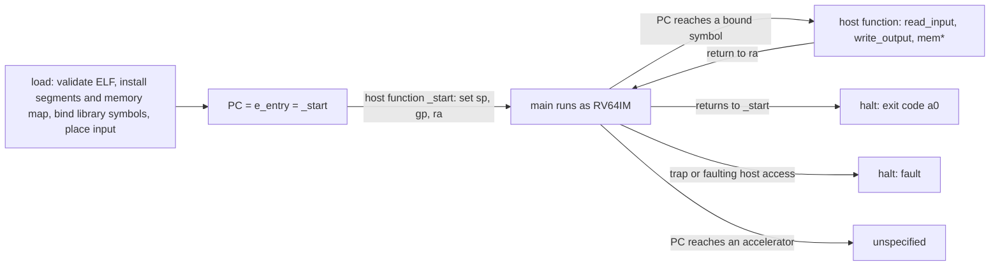

# zkVM reference platform (v2)

An executable reference for the merged zkvm-standards (upstream `main` at `f433d48`): a RISC-V zkVM
platform written in Sail (machine and loader), and the run loop and compliance statements written in
Lean. Nothing outside Sail and Lean is part of the specification; the scripts and tests only build
and exercise it.

| Language | Specifies                                                    | Where                                            |
| -------- | ------------------------------------------------------------ | ------------------------------------------------ |
| Sail     | RV64IM base machine (pinned [sail-riscv](sail-riscv),        | `sail-riscv/`                                    |
|          | `bdce62fe`, unmodified)                                      |                                                  |
| Sail     | Memory profile, run state (input, public output, halt        | `sail/zkvm/zkvm_state.sail`                      |
|          | outcome, misaligned-access count), termination               |                                                  |
| Sail     | Host functions of the static library: which exist, their     | `sail/zkvm/zkvm_host.sail`                       |
|          | symbols, when they run, what they do                         |                                                  |
| Sail     | Loader: ELF parsing, validation against the memory profile,  | `sail/zkvm/zkvm_loader.sail`                     |
|          | the memory map, symbol binding                               |                                                  |
| Sail     | Machine initialisation: memory attributes, reset values,     | `sail/zkvm/zkvm_install.sail`                    |
|          | segment bytes, host bindings, input                          |                                                  |
| Sail     | One zkVM step: host function or instruction; every trap is a | `sail/zkvm/zkvm_step.sail`                       |
|          | fault; misaligned data accesses are counted                  |                                                  |
| Lean     | Decoding memory-profile files; passing file bytes to the     | `lean/ZkvmRef/MemoryProfile.lean`, `Loader.lean` |
|          | Sail loader                                                  |                                                  |
| Lean     | Run loop and observations                                    | `lean/ZkvmRef/Run.lean`                          |
| Lean     | Compliance statements for zkVMs and vendor static libraries  | `lean/ZkvmRef/Compliance.lean` (vocabulary in    |
|          |                                                              | `StaticLibrary.lean`)                            |

The Lean model of the Sail machine is generated by Sail's Lean backend, so the Lean reference
executes the Sail definitions; it is the only executable reference.

## What goes in Sail and what goes in Lean

Platform definitions and logic go in Sail: the machine's state and every state change a guest can
observe, the properties of the zkVM (memory profile, guard regions, reset values, memory
attributes), and the loader. The exceptions:

- **Statements** are Lean: Sail has no propositions or quantifiers.
- **Accelerator (precompile) specifications** will be Lean, or another formal-verification language:
  hash functions and curve operations have, or will have, canonical formal specifications. Sail
  keeps the machine-facing part (arguments, memory access, faults) and would call them as external
  functions.
- **Performance**: code may move to a more conventional language if Sail's generated code proves too
  slow. Nothing has needed this so far: loading and running an 8.4 MB guest with 4 MB of initialised
  data takes 14.5 s with the loader in Sail, against 7.6 s with the earlier Lean loader.

What remains in Lean is not platform logic: decoding input files (memory profiles, ELF bytes) into
Sail values, the step-bounded run loop and the CLI, and the statements.

Why Sail for the platform: Sail also generates C, SMT, Isabelle and Rocq, so a platform defined
entirely in Sail can be reused (an emulator, a differential-testing oracle, SMT checks), and one
language for the platform means one definition to audit, reviewable by the RISC-V and sail-riscv
community.

## Run model



A static-library call is the PC reaching the address of a library symbol; the machine then performs
the host function instead of fetching. `_start` is a host function too: the first time it calls
`main`, and `main` returning to it ends the run with `main`'s return value (0 = success). Any trap
ends the run with a fault.

The base layer holds the machine, the loader core and the run loop. Each standard adds its part
(host functions, loader checks, trap handling) in its own layer, with a `Normative requirements`
table in the standard's README; `scripts/check-requirements.py` checks that every requirement the
reference enforces is tagged `[ID]` where it is enforced.

## Build and test

Prerequisites: `riscv64-unknown-elf-gcc`, `z3`, `elan`, `python3`, and network access for the Sail
release and the `lean-sail` dependency. From the repository root:

```sh
git submodule update --init reference/sail-riscv
reference/scripts/build-lean.sh      # generate the Lean model, build it and reference/lean
python3 reference/tests/run.py       # guests (with zero and canary registers) and loader rejections
python3 reference/scripts/check-requirements.py   # requirement IDs are tagged in the reference
```

`reference/lean/.lake/build/bin/zkvm-run [--canary] PROFILE ELF INPUT [FUEL]` runs one guest and
prints `outcome=… output=<hex> misaligned=<count>`, or `REJECT <message>` (exit 2) if the loader
rejects the ELF. Integer registers `x1`…`x31` start at 0, or at a distinct nonzero pattern with
`--canary`; the standards leave them unspecified, so a guest's observation must not change.

Contributors: run `reference/scripts/install-git-hooks.sh` once; the pre-commit hook formats staged
markdown under `reference/` with `reference/scripts/md-wrap-prose` (needs `prettier`) and refuses
the commit if the formatter cannot run.

## Limits

- The Lean model is generated from the I and M instruction modules, which hold every instruction of
  the target `riscv64im_zicclsm` (Zicclsm adds no instructions; see
  [`config/README.md`](config/README.md)). All of sail-riscv cannot be generated: its `instruction`
  type has 355 constructors and Lean allows at most 244 (see `scripts/build-lean.sh`).
- Nothing is proved: the statements are definitions of type `Prop`.
- Accelerator semantics are unspecified: a run that calls one ends with `unspecified:<symbol>`, and
  the compliance statements make no claim about it.
- Reading memory that was never written (outside loaded segments and the input), or a register that
  has no initial value (see [`sail/README.md`](sail/README.md)), makes a run `stuck`: the generated
  model has no value for it.
- Host functions are bound through the ELF symbol table, although the ELF standard builds the image
  from program headers only.

## Layout

| Directory                                       | Contents                                         |
| ----------------------------------------------- | ------------------------------------------------ |
| [`sail/`](sail/README.md)                       | zkVM Sail modules and their project file         |
| [`config/`](config/README.md)                   | sail-riscv configuration overlays                |
| [`scripts/`](scripts/README.md)                 | build scripts                                    |
| [`memory-profiles/`](memory-profiles/README.md) | memory profiles                                  |
| [`lean/`](lean/README.md)                       | Lean reference and `zkvm-run`                    |
| [`tests/`](tests/README.md)                     | stub library, linker script, guests, test runner |
| `sail-riscv/`                                   | pinned sail-riscv submodule (unmodified)         |
| `build/`                                        | generated, ignored                               |
