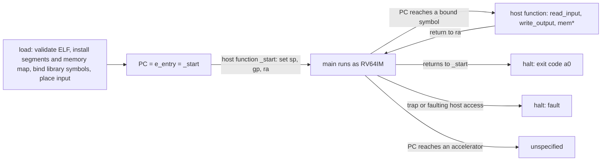

# zkVM reference platform (v2)

An executable reference for the merged zkvm-standards (upstream `main` at `f433d48`): a RISC-V
machine written in Sail and a loader, host-function semantics and compliance statements written
in Lean. Nothing outside Sail and Lean is part of the specification; the scripts and tests only
build and exercise it.

| Language | Specifies | Where |
|---|---|---|
| Sail | RV64IM base machine (pinned [sail-riscv](sail-riscv), `bdce62fe`) | `sail-riscv/`, `sail/hooks.patch` |
| Sail | zkVM state: input location, public output, halt outcome, misaligned-access count | `sail/zkvm/zkvm_state.sail` |
| Sail | Termination: `main`'s return value or a fault; every trap is a fault | `sail/zkvm/zkvm_termination.sail` |
| Sail | Host functions of the static library: which exist, their symbols, when they are invoked; checked byte access | `sail/zkvm/zkvm_host.sail` |
| Lean | ELF parsing | `lean/ZkvmRef/Elf.lean` |
| Lean | Loader: validation, image installation, host-function binding, input placement | `lean/ZkvmRef/Loader.lean` |
| Lean | Semantics of each host function | `lean/ZkvmRef/Host.lean` |
| Lean | Run loop and observations | `lean/ZkvmRef/Run.lean` |
| Lean | Static-library predicates, loader and compliance statements | `lean/ZkvmRef/StaticLibrary.lean`, `LoaderSpec.lean`, `Spec.lean` |

The Lean model of the Sail machine is generated by Sail's Lean backend, so the Lean reference
executes the Sail definitions; it is the only executable reference.

## Run model



A static-library call is the PC reaching the address of a library symbol; the machine then
performs the host function instead of fetching. `_start` is a host function too: the first time
it calls `main`, and `main` returning to it ends the run with `main`'s return value
(0 = success). Any trap ends the run with a fault.

## Build and test

Prerequisites: `riscv64-unknown-elf-gcc`, `z3`, `elan`, `python3` with `pyelftools`, and network
access for the Sail release and the `lean-sail` dependency. From the repository root:

```sh
git submodule update --init reference/sail-riscv
reference/scripts/build-lean.sh      # generate the Lean model, build it and reference/lean
python3 reference/tests/run.py       # guests and loader rejections against zkvm-run
```

`reference/lean/.lake/build/bin/zkvm-run PROFILE ELF INPUT [FUEL]` runs one guest and prints
`outcome=… output=<hex> misaligned=<count>`, or `REJECT <message>` (exit 2) if the loader
rejects the ELF.

## Limits

- The Lean model is generated from the I and M instruction modules only (the full model exceeds
  Lean's constructor limit); the configuration enables no other instruction extension.
- Nothing is proved: the statements are definitions of type `Prop`.
- Accelerator semantics are unspecified: a run that calls one ends with
  `unspecified:<symbol>`, and the compliance statements make no claim about it.
- Reading memory that was never written (outside loaded segments and the input) makes a run
  `stuck`: the generated model has no value for such bytes.
- Host functions are bound through the ELF symbol table, although the ELF standard builds the
  image from program headers only; the loader rejects ELFs without `_start`, `main`,
  `read_input` or `write_output`.
- Host randomness is not part of v2.

## Layout

| Directory | Contents |
|---|---|
| [`sail/`](sail/README.md) | zkVM Sail modules and the sail-riscv hooks patch |
| [`config/`](config/README.md) | sail-riscv configuration overlays |
| [`scripts/`](scripts/README.md) | build scripts |
| [`profiles/`](profiles/README.md) | memory profiles |
| [`lean/`](lean/README.md) | Lean reference and `zkvm-run` |
| [`tests/`](tests/README.md) | stub library, linker script, guests, test runner |
| `sail-riscv/` | pinned sail-riscv submodule (unmodified) |
| `build/` | generated, ignored |
